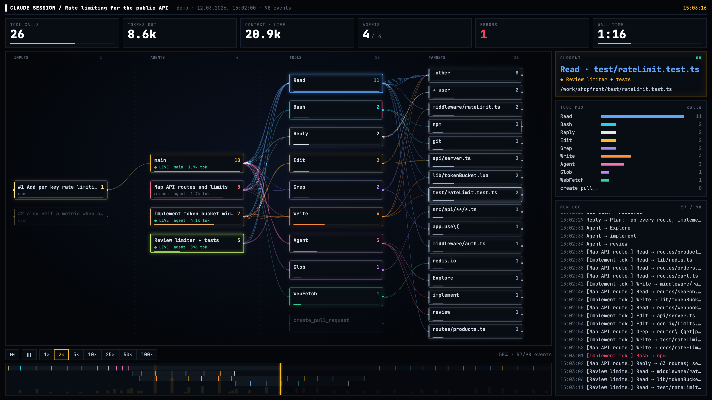

# claude-session-visualizer

**Replay a Claude Code agent session as an animated mission-control view.** Prompts flow into agents, agents into tools, tools into the files and commands they touch. Subagents get their own lanes, errors flash red, and you can scrub through the whole run on a timeline.



<sub>Demo data: a made-up session from [`examples/demo.jsonl`](examples/demo.jsonl).</sub>

## Quick start

```bash
git clone git@github.com:evgeny-s/claude-session-visualizer.git && cd claude-session-visualizer
python3 -m agentviz
```

This opens a local page with a session picker over your own `~/.claude/projects`. Pick a session and it starts playing. Python 3.9+, no dependencies. If you have no sessions yet, the page plays the demo.

```bash
python3 -m agentviz                       # web UI with session picker (127.0.0.1 only)
python3 -m agentviz --list                # recent sessions in the terminal
python3 -m agentviz <id-prefix>           # standalone out/<id>.html, opens in the browser
python3 -m agentviz examples/demo.jsonl   # any exported / Agent SDK transcript file
```

## What you see

| Column | Meaning |
|---|---|
| **Inputs** | user prompts and injected system messages |
| **Agents** | the main agent and every subagent, with live/done status and token count |
| **Tools** | Bash, Read, Edit, Agent, MCP tools…, sized by call count |
| **Targets** | files, commands, domains, and subagent types the tools touched |

The top bar shows tool calls, output tokens, current context size, active agents, errors and wall time. The right panel shows the current step with its result, the tool mix and a run log. The bottom bar is the timeline: one lane per agent, with token volume underneath.

**Controls:** `space` plays/pauses, `←`/`→` seeks, `R` restarts, `O` opens the session picker. Speed buttons go from 1× to 100×. Idle gaps are compressed to 4 s, so a multi-hour session plays in minutes. Add `#t=0.6` to a URL to start at 60%.

**Pasting a transcript:** the picker accepts Claude Code JSONL, a JSON array of entries, or an Agent SDK `stream-json` run, raw or wrapped as `{"transcript": [...]}`. You can paste it or drop the file in. SDK streams carry no per-step timestamps, so their timing is spread evenly over the run and the header marks it *synthetic*.

## Privacy

Everything stays local. The server binds `127.0.0.1` and reads only `~/.claude/projects`. Session URLs accept ids, never paths. A generated `out/*.html` embeds clipped commands and prompts from that session, so review it before sharing.

## Layout

```
agentviz/        Python backend (stdlib only)
  transcript.py  session / SDK transcript -> timeline events
  sessions.py    discover and search sessions in ~/.claude/projects
  render.py      inline ui/ + data into one self-contained HTML page
  server.py      local web UI: picker, paste, player
  __main__.py    CLI
ui/              index.html, style.css, app.js (canvas player), picker.js (session modal)
examples/        demo transcript
tests/           python3 tests/test_agentviz.py
```
